# 🚀 First INT4 Quantized Efficient-CubePart3D - 83% Smaller Part Decomposition Model
-blueviolet)
-brightgreen)
-blue)
-orange)

Code for INT4 weight-only quantization of the diffusion transformer in Roblox's
[CubePart](https://huggingface.co/Roblox/cubepart) and for the BF16 vs INT4
benchmark. Released weights and model card:
[TrNi/efficient-cubepart3d](https://huggingface.co/TrNi/efficient-cubepart3d).

Quantization: HQQ (Half-Quadratic Quantization, calibration-free) through
`torchao.quantization.int4_weight_only(group_size=128, use_hqq=True)`, W4A16,
applied only to `transformer_blocks` and `multi_transformer_blocks` inside
`diffusion_model`.

## Results (clean full sweep, SLURM job 1159996)

250 prompts, 12 categories, 828 parts, fully seeded pipeline (the chamfer
distance of a configuration against itself is exactly 0).

| | min | median | mean | max |
|---|---|---|---|---|
| CD(A,B): BF16 Cube3D input, BF16 vs INT4 CubePart | 0.0011 | 0.0114 | 0.0193 | 0.8206 |
| CD(C,D): INT4 Cube3D input, BF16 vs INT4 CubePart | 0.0014 | 0.0118 | 0.0239 | 1.6261 |

| | BF16 | INT4 |
|---|---|---|
| Diffusion transformer on disk | 8.582 GB | 1.479 GB (82.8% smaller) |
| Peak VRAM during generation | 33.71 GiB | 27.09 GiB (19.6% lower) |
| Latency per generation (mean, 10 meshes) | 34.7 s | 66.5 s (eager mode) |

Full per-prompt, per-category and dataset statistics for both pairs:
`cd_stats.json` (output of `compute_4config_cd_stats.py` for job 1159996).

File sizes are decimal GB from exact byte counts; VRAM is GiB from
`torch.cuda.max_memory_allocated()`. Measured on one L40S.

## BF16 vs INT4 renders

Full mesh on top, CubePart parts below. Rendered with spherical harmonic lighting, Blinn-Phong specular and ambient occlusion: gray only, no color, so the geometry itself shows.

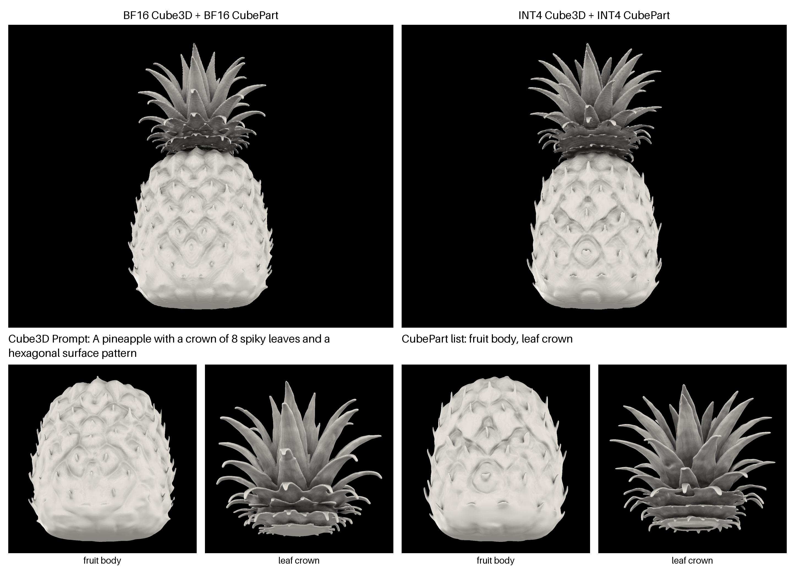

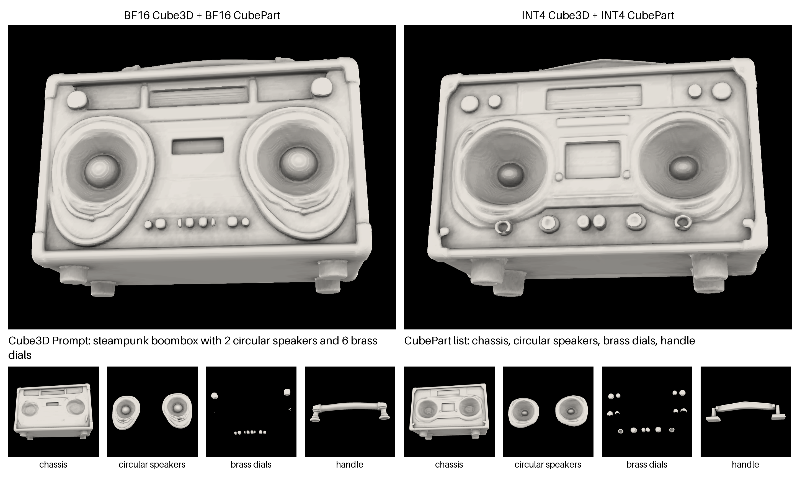

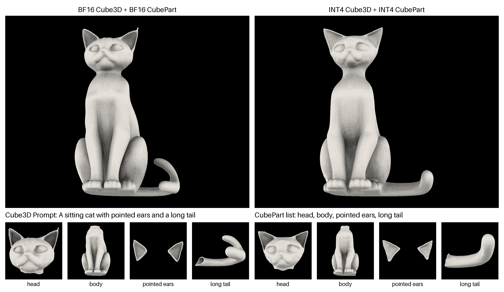

### Shaded renders: BF16 vs INT4

| Prompt | BF16 | **INT4** |
|---|:-:|:-:|
| A pineapple with a crown of 8 spiky leaves and a hexagonal surface pattern | 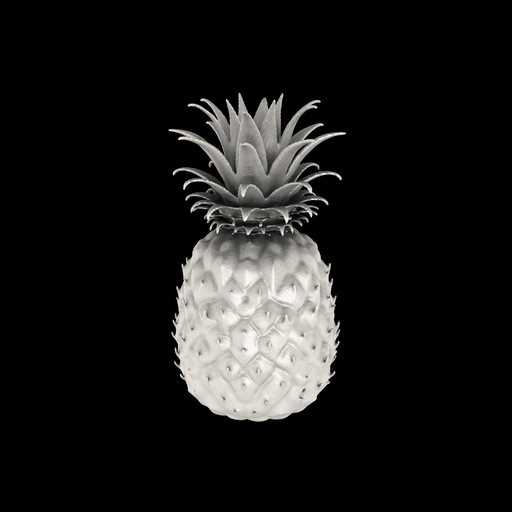 | 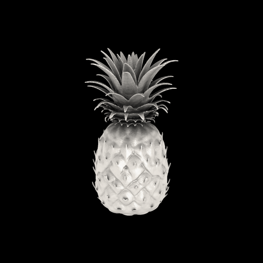 |
| steampunk boombox with 2 circular speakers and 6 brass dials | 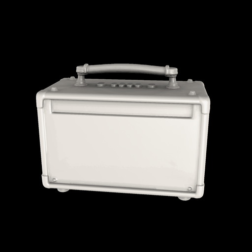 | 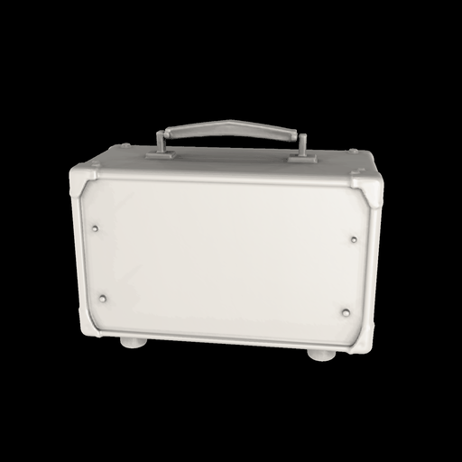 |
| A sitting cat with pointed ears and a long tail | 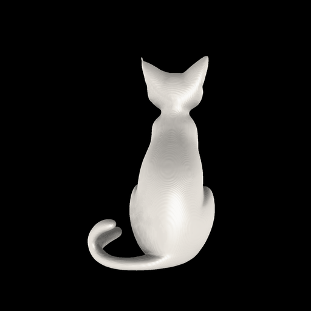 | 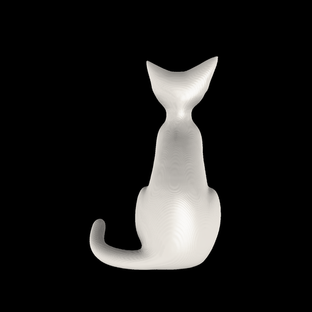 |
| A lace doily pattern extruded to a thin 3D surface | 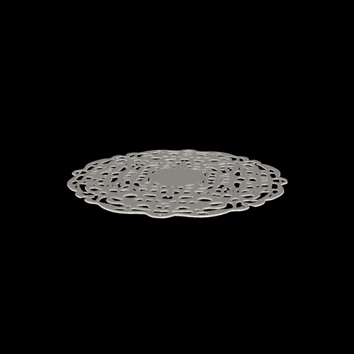 | 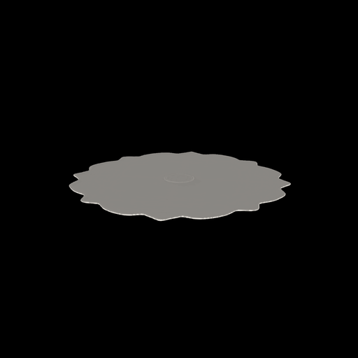 |

Rendered with spherical harmonic lighting, Blinn-Phong specular and ambient occlusion: gray only, no color, so the geometry itself shows. The lace doily is a failure case: INT4 loses the lace pattern.

## Scripts

All scripts run from the CubePart repo root (`cube/cubepart`) with:

```bash
export PYTHONPATH=.
export PYTORCH_CUDA_ALLOC_CONF=expandable_segments:True   # avoids Warp marching cubes OOM
export TORCHDYNAMO_DISABLE=1                               # avoids a Dynamo error in hijack_qwenimage_multi.py
```

Benchmark
- `benchmark_4config_sweep.py`: 4-config sweep (A/B/C/D, see below), writes per-mesh `<idx>_ab.json` / `<idx>_cd.json`, resumable.
- `full_sweep_4config.slurm`: SLURM wrapper (`gpu-l40s`, 23 h), runs the sweep then the stats.
- `compute_4config_cd_stats.py`: aggregates per-mesh results to per-prompt, per-category and dataset statistics.
- `measure_efficiency.py`: latency, setup time and peak VRAM for BF16 and INT4.
- `migrate_cd_sum_to_average.py`: one-time fix for results written when chamfer distance was a sum of the two directions instead of their average. Not needed for new runs.

Parts lists
- `parts_override.json`: the 250 per-prompt parts lists used for every number above (written by `rebuild_parts_override.py`).
- `rebuild_parts_override.py`: holds the 250 lists; validates them and writes `parts_override.json` with `--apply`.
- `spot_check_parts_override.py`: flags implausible part names against the `master_suite.json` prompts.
- `audit_alignment.py`: per-category prompt to parts word overlap (healthy file: 0 to 15% zero-overlap; the shuffled one was 55 to 85%).
- `diagnose_shuffle.py`: tells a constant offset (recoverable) from a true shuffle (rebuild needed).
- `inspect_defects.py`: prints flagged entries with their two neighbours on each side.
- These read `nisarg_shared/parts_override.json` and `master_suite.json`, the cluster layout.

Checkpoint
- `test_int4_checkpoint_save.py`: compares three save/reload patterns on a small module.
- `export_int4_checkpoint.py`: saves `multi_part_dit_int4_hqq_g128.pt` and verifies a bit-exact reload with a real generation.
- `export_int4_safetensors.py`: converts the checkpoint to `.safetensors` with a bit-exact verify step. Passed in job 1215174 (1,478,462,752 bytes).
- `export_safetensors.slurm`: SLURM wrapper for the export; the verify runs in a fresh process.
- `time_load_paths.py`, `time_load_paths.slurm`: time repeated generations per load path (bf16, pt, st). Result: st = pt (64.6 s).

Meshes
- `select_visual_prompts.py`, `select_3_demo_prompts.py`: pick prompts for the mesh package.
- `export_visual_assets.py`: exports Cube3D whole meshes and CubePart part meshes as `.glb` with a `manifest.json`.
- `load_parts_example.py`, `tutorial_part_mapping.py`: map part files back to part names.
- `render_sh_spec_ao.py`: CPU-only SH / specular / AO clay renderer (parameters not tuned against a reference). Superseded by the `SH_BPS_AO` renderer below.

Renders
- `sh_bps_ao_colab.ipynb`: `SH_BPS_AO` renderer (nvdiffrast + Embree AO), 18 Fibonacci-sphere views per mesh, run on Colab; produced every render above. Adapted from Nisarg Trivedi's notebook: rows flipped because nvdiffrast row 0 is the image bottom; no upright rotation (our meshes are +y up).
- `sh_figures_colab.ipynb`: builds the BF16 vs INT4 figures and turntable GIFs from the renders. No GPU needed.
- `render_sh_bps_ao.py`, `render_sh_bps_ao.slurm`: the same renderer as a SLURM job. Not yet run on a GPU.

Earlier scripts kept for history: `quantize_cubepart_rtn.py`, `benchmark_spot_check.py`,
`benchmark_cubepart_bf16_vs_int4.py`, `probe_cuda.py`, `test_cube3d.py`, and
`benchmark_full_sweep.py` (original 2-config sweep: unseeded sampling and chamfer
distance as a sum, so its numbers are not comparable; replaced by
`benchmark_4config_sweep.py`).

## Experimental design

| Config | Cube3D input mesh | CubePart model |
|---|---|---|
| A | BF16 | BF16 |
| B | BF16 | INT4 |
| C | INT4 | BF16 |
| D | INT4 | INT4 |

The diffusion model is quantized once, in place, between the A/C pass and the
B/D pass. Surface sampling and the chamfer metric are both seeded per mesh
(`seed = idx`). Chamfer distance is the average of the forward and backward
mean nearest neighbour distances over 5000 sampled points per part.

<!-- ## Superseded: spot check, 2 meshes (August 2026)

Kept for the record; do not cite. These numbers came before the sampling seed
fix and the rebuilt parts lists, and the VRAM figures were not a true
generation-time peak.

- BF16 peak VRAM 28.33 GB; INT4 peak VRAM 21.23 GB (an INT4-only run gave 11.68 GB)
- CD median across all parts: 0.539
- Latency: BF16 about 48 to 57 s per mesh, INT4 about 64 to 70 s per mesh

See `spot_check_summary.json`.
-->
